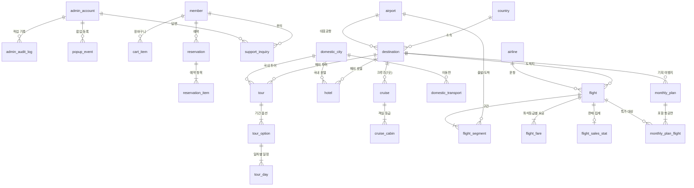

# nado_gam DB 설계서

> DBMS: MySQL 8 / 문자셋 utf8mb4 / 작성일: 2026-11-19 (초안) / 개정: 2026-11-20 (추가 요구사항 테이블 12개 추가, 3-5절 참고)
> 관리자 영역과 사용자 영역을 구분해서 설계했다.

## 1. 영역 구분

| 영역 | 테이블 | 설명 |
|---|---|---|
| **[A] 관리자 영역** | `admin_account`, `admin_audit_log`, `popup_event` | 관리자 계정, 작업 이력, 이벤트 팝업(관리자가 등록) |
| **[U] 사용자 영역** | `member`, `cart_item`, `reservation`, `reservation_item`, `support_inquiry` | 사용자 계정, 장바구니, 예약(모의 결제), 고객문의 |
| **[M] 운영 마스터** | `country`, `airport`, `destination`, `airline`, `flight`, `flight_segment`, `flight_fare`, `monthly_plan`, `monthly_plan_flight`, `flight_sales_stat`, `domestic_city`, `domestic_transport`, `tour`, `tour_option`, `tour_day`, `hotel`, `cruise`, `cruise_cabin` | 관리자가 등록·수정하고 사용자는 조회만 함 |

11/20 개정: 예약은 2단계에서 이번 범위로 옮겼다(장바구니 + 모의 결제). 실제 결제·좌석 재고 차감·동시성 제어는 2단계다.

규칙: 관리자와 사용자 계정은 **같은 테이블에 두지 않는다.** 로그인, 권한, 세션 처리가 서로 섞이지 않게 한다.

## 2. ERD



## 3. 테이블 정의서

### 3-1. [A] 관리자 영역

**admin_account** (관리자 계정)

| 컬럼 | 타입 | 제약 | 설명 |
|---|---|---|---|
| admin_id | BIGINT | PK, AI | |
| login_id | VARCHAR(30) | UNIQUE, NOT NULL | 로그인 아이디 |
| password_hash | VARCHAR(100) | NOT NULL | BCrypt 해시 |
| name | VARCHAR(50) | NOT NULL | |
| phone | VARCHAR(20) | NOT NULL | |
| email | VARCHAR(100) | UNIQUE, NOT NULL | |
| role | VARCHAR(20) | NOT NULL, 기본 `ROLE_ADMIN` | |
| status | VARCHAR(10) | NOT NULL, 기본 `ACTIVE` | ACTIVE / LOCKED |
| last_login_at | DATETIME | NULL | |
| created_at | DATETIME | NOT NULL | |

**admin_audit_log** (관리자 작업 이력)

| 컬럼 | 타입 | 제약 | 설명 |
|---|---|---|---|
| log_id | BIGINT | PK, AI | |
| admin_id | BIGINT | FK → admin_account | |
| action | VARCHAR(30) | NOT NULL | CREATE / UPDATE / DELETE / LOGIN |
| target_table | VARCHAR(50) | NOT NULL | |
| target_id | VARCHAR(50) | NULL | |
| detail | TEXT | NULL | 변경 내용 |
| created_at | DATETIME | NOT NULL | |

### 3-2. [U] 사용자 영역

**member** (사용자 계정)

| 컬럼 | 타입 | 제약 | 설명 |
|---|---|---|---|
| member_id | BIGINT | PK, AI | |
| login_id | VARCHAR(30) | UNIQUE, NOT NULL | |
| password_hash | VARCHAR(100) | NOT NULL | BCrypt 해시 |
| name | VARCHAR(50) | NOT NULL | |
| phone | VARCHAR(20) | NOT NULL | |
| email | VARCHAR(100) | UNIQUE, NOT NULL | |
| role | VARCHAR(20) | NOT NULL, 기본 `ROLE_USER` | |
| status | VARCHAR(10) | NOT NULL, 기본 `ACTIVE` | ACTIVE / SUSPENDED / WITHDRAWN |
| created_at | DATETIME | NOT NULL | |
| updated_at | DATETIME | NOT NULL | |
| withdrawn_at | DATETIME | NULL | 탈퇴 일시(소프트 삭제) |

장바구니·예약·고객문의 테이블은 3-5절에서 정의한다. (이전 초안의 `reservation_passenger`는 탑승객 정보를 받는 2단계 기능이라 이번 범위에서 뺐다.)

### 3-3. [M] 운영 마스터

**country** (국가)

| 컬럼 | 타입 | 설명 |
|---|---|---|
| country_code | CHAR(2) PK | ISO 국가 코드 (KR, JP …) |
| name_ko / name_en | VARCHAR(50) | |
| region | VARCHAR(20) | EUROPE / ASIA / NORTH_AMERICA / SOUTH_AMERICA / MIDDLE_EAST / AFRICA / OCEANIA |

**airport** (공항)

| 컬럼 | 타입 | 설명 |
|---|---|---|
| airport_code | CHAR(3) PK | IATA 코드 (ICN, CDG …) |
| name_ko / name_en | VARCHAR(100) | |
| city_name_ko | VARCHAR(50) | |
| country_code | CHAR(2) FK | |
| latitude / longitude | DECIMAL(9,6) | **지구본 좌표** |
| timezone | VARCHAR(40) | 예: Asia/Seoul |
| is_hub | BOOLEAN | 경유 거점 여부 (FRA, IST, DXB …) |

**destination** (여행지 = 27개 도시)

| 컬럼 | 타입 | 설명 |
|---|---|---|
| destination_id | BIGINT PK AI | |
| name_ko / name_en | VARCHAR(50) | |
| country_code | CHAR(2) FK | |
| main_airport | CHAR(3) FK | 대표 공항 |
| latitude / longitude | DECIMAL(9,6) | 도시 중심 좌표 |
| status | VARCHAR(15) | AVAILABLE / UNAVAILABLE |
| unavailable_reason | VARCHAR(200) | 운항 불가 사유 (블라디보스토크 등) |
| summary | VARCHAR(300) | 한 줄 소개 |
| image_url | VARCHAR(300) | 사진 포스터용(지금은 비워 둠) |
| poster_color_from / poster_color_to | CHAR(7) | 카드 포스터 그라데이션 색(#RRGGBB). 사진이 없을 때 CSS 로 포스터를 만든다 |
| sort_order | INT | |

**airline** (항공사)

| 컬럼 | 타입 | 설명 |
|---|---|---|
| airline_code | VARCHAR(3) PK | 항공사 코드 (MG, AQ …). **실제 항공사와 무관한 가상 코드**이다 |
| name_ko / name_en | VARCHAR(50) | |
| carrier_type | VARCHAR(5) | FSC(일반) / LCC(저비용) |

**flight** (항공편)

| 컬럼 | 타입 | 설명 |
|---|---|---|
| flight_id | BIGINT PK AI | |
| flight_no | VARCHAR(10) | 편명 |
| airline_code | VARCHAR(3) FK | |
| destination_id | BIGINT FK | 도착 도시 |
| origin_airport | CHAR(3) FK | 최초 출발 공항 |
| arrival_airport | CHAR(3) FK | 최종 도착 공항 |
| flight_type | VARCHAR(10) | DIRECT / CONNECTING |
| stops | TINYINT | 경유 횟수 (직항 0) |
| departure_time | TIME | 출발 시각(출발지 현지) |
| arrival_time | TIME | 도착 시각(도착지 현지) |
| arrival_day_offset | TINYINT | 도착이 며칠 뒤인지 (0/1) |
| duration_minutes | INT | 총 소요 시간(분, 경유 대기 포함) |
| aircraft | VARCHAR(30) | 기종 |
| baggage_kg | INT | 위탁 수하물 무게 |
| meal_included | BOOLEAN | 기내식 |
| operating_days | VARCHAR(7) | 운항 요일 (예: 1111111) |
| status | VARCHAR(10) | ON_SALE / SOLD_OUT / SUSPENDED |
| created_at / updated_at | DATETIME | |

**flight_segment** (경유 구간. 직항도 구간 1개)

| 컬럼 | 타입 | 설명 |
|---|---|---|
| segment_id | BIGINT PK AI | |
| flight_id | BIGINT FK | |
| seq | TINYINT | 구간 순서 (1, 2) |
| from_airport / to_airport | CHAR(3) FK | |
| duration_minutes | INT | 구간 비행시간 |
| layover_minutes | INT | 다음 구간 대기 시간 (마지막 구간은 NULL) |

**flight_fare** (좌석등급별 요금)

| 컬럼 | 타입 | 설명 |
|---|---|---|
| fare_id | BIGINT PK AI | |
| flight_id | BIGINT FK | |
| cabin_class | VARCHAR(10) | ECONOMY / PREMIUM / BUSINESS / FIRST |
| base_price | INT | 운임 (원) |
| tax_fuel | INT | 세금·유류할증료 |
| seats_total | INT | 총 좌석 수 |
| seats_left | INT | 잔여 좌석 |
| refundable | BOOLEAN | 환불 가능 여부 |
| change_fee | INT | 변경 수수료 |
| mileage_rate | DECIMAL(3,2) | 마일리지 적립률 |
| version | BIGINT | **낙관적 락**(동시 예약 대비) |

표시 가격 = `base_price + tax_fuel` (더미 CSV 의 가격이 이 합계이다. 세금·유류할증료는 총 소요시간 기준 3만/6만/12만/15만 원). UNIQUE(flight_id, cabin_class). 좌석등급을 갖지 않는 항공편(예: LCC는 일반석만)은 해당 행을 만들지 않는다.

**monthly_plan** (이달의 특별기획)

| 컬럼 | 타입 | 설명 |
|---|---|---|
| plan_id | BIGINT PK AI | |
| plan_month | CHAR(7) | 예: 2026-11 |
| destination_id | BIGINT FK | 기획 여행지 |
| title / subtitle | VARCHAR(100/200) | 마케팅 문구 |
| badge_text | VARCHAR(20) | 예: "최대 32% OFF" |
| highlights | VARCHAR(500) | 추천 포인트 (줄바꿈 구분 3줄) |
| start_at / end_at | DATETIME | 노출·특가 기간 |
| is_active | BOOLEAN | |
| banner_image | VARCHAR(300) | |

**monthly_plan_flight** (기획전 항공편과 특가)

| 컬럼 | 타입 | 설명 |
|---|---|---|
| plan_id / flight_id / cabin_class | FK 복합 PK | 등급마다 특가가 달라서 cabin_class 를 PK 에 포함 (구현 시 확정) |
| sale_price | INT | 특가 |
| original_price | INT | 정가(취소선 표시용) |
| limited_seats | INT | 특가 한정 좌석 수 |
| display_order | INT | |

**flight_sales_stat** (베스트셀러 집계)

| 컬럼 | 타입 | 설명 |
|---|---|---|
| flight_id | BIGINT PK FK | |
| sales_count | INT | 누적 판매 수 (초기 더미 → 예약 기능 후 실제 집계) |
| rank_no | INT | 순위 (집계 후 갱신) |
| updated_at | DATETIME | |

### 3-4. 출발지 목록 조회 (여행지 선택 후)

출발지는 별도 컬럼이 아니라 항공편 데이터에서 구한다. (확정 11/19)

```sql
SELECT DISTINCT a.airport_code, a.name_ko, a.city_name_ko
FROM flight f
JOIN airport a ON a.airport_code = f.origin_airport
WHERE f.destination_id = :destinationId
  AND f.status = 'ON_SALE'
ORDER BY a.city_name_ko;
```

`flight(destination_id, origin_airport)` 복합 인덱스를 둔다.

### 3-5. 추가 요구사항 테이블 (11/20 추가)

모든 이름·브랜드·가격은 가상 데이터다. 상태·종류 값은 VARCHAR 로 두고 허용 값을 설명에 적는다.

#### 국내여행

**domestic_city** (국내 여행지 10곳)

| 컬럼 | 타입 | 설명 |
|---|---|---|
| city_id | BIGINT PK AI | |
| name_ko | VARCHAR(30) | 경주, 강릉, 속초, 부산, 제주, 전주, 여수, 순천, 통영, 단양 |
| province | VARCHAR(20) | 경북, 강원, 경남, 제주, 전북, 전남 등 |
| latitude / longitude | DECIMAL(9,6) | |
| summary | VARCHAR(300) | 한 줄 소개 |
| poster_color_from / poster_color_to | CHAR(7) | 포스터 그라데이션 |
| status / sort_order | VARCHAR(15) / INT | AVAILABLE / HIDDEN |

**domestic_transport** (국내 이동편, 도시당 5개 = 50개)

| 컬럼 | 타입 | 설명 |
|---|---|---|
| transport_id | BIGINT PK AI | |
| city_id | BIGINT FK | 도착 도시 |
| origin | VARCHAR(10) | SEOUL / DAEJEON |
| mode | VARCHAR(10) | BUS / TRAIN / AIR (AIR 는 제주만, 김포→제주) |
| operator_name | VARCHAR(50) | 가상 운수사·열차 이름 |
| service_grade | VARCHAR(20) | 일반 / 우등 / 특실 등 |
| departure_time | TIME | |
| duration_minutes | INT | |
| price | INT | 편도 성인 1인 (원) |
| status | VARCHAR(10) | ON_SALE / SUSPENDED |

#### 투어

**tour** (투어 상품. 해외는 여행지 1~3개, 국내는 도시당 3개)

| 컬럼 | 타입 | 설명 |
|---|---|---|
| tour_id | BIGINT PK AI | |
| scope | VARCHAR(10) | OVERSEAS / DOMESTIC |
| destination_id | BIGINT FK NULL | 해외 투어의 여행지 |
| city_id | BIGINT FK NULL | 국내 투어의 도시 (둘 중 하나만 채움) |
| theme | VARCHAR(20) | FOOD_DRINK(음식과 주류) / SPORTS_ACTIVITY(스포츠와 액티비티) / ART_REST(예술과 휴식) |
| title / subtitle | VARCHAR(100/200) | 투어 이름·부제 (가상) |
| collab_brand | VARCHAR(50) NULL | 콜라보 브랜드 이름(식료품·주류 등, **가상**) |
| highlights | VARCHAR(500) | 추천 포인트 |
| includes / excludes | VARCHAR(500) | 포함·불포함 |
| source_note | VARCHAR(200) NULL | 참고한 실제 특산물·관광상품 설명(웹 조사 메모) |
| status / sort_order | VARCHAR(10) / INT | ON_SALE / HIDDEN |

UNIQUE(destination_id, theme), UNIQUE(city_id, theme).

**tour_option** (기간 옵션. 투어당 3개)

| 컬럼 | 타입 | 설명 |
|---|---|---|
| option_id | BIGINT PK AI | |
| tour_id | BIGINT FK | |
| nights / days | TINYINT | 인천 기준 비행 6시간 이하: 2박3일·3박4일·6박7일, 초과: 6박7일·9박10일·13박14일 (국내는 1박2일·2박3일·3박4일 제안) |
| price_per_person | INT | 1인 가격 (원). 항공권 제외 현지 상품가 |
| min_people / max_people | TINYINT | |

**tour_day** (일차별 일정)

| 컬럼 | 타입 | 설명 |
|---|---|---|
| tour_day_id | BIGINT PK AI | |
| option_id | BIGINT FK | |
| day_no | TINYINT | 1일차, 2일차 … |
| title | VARCHAR(100) | |
| description | VARCHAR(500) | |

#### 호텔

**hotel** (해외 여행지당 3개 / 기획전·베스트셀러 6곳은 7개 / 국내 도시당 3개 = 총 201개)

| 컬럼 | 타입 | 설명 |
|---|---|---|
| hotel_id | BIGINT PK AI | |
| scope | VARCHAR(10) | OVERSEAS / DOMESTIC |
| destination_id / city_id | BIGINT FK NULL | 둘 중 하나만 채움 |
| name_ko / name_en | VARCHAR(100) | **가상 호텔 이름** |
| grade | TINYINT | 성급 (3~5) |
| area | VARCHAR(100) | 위치 설명 |
| price_per_night | INT | 1박 기준 가격 (원). 전체 가격 = 1박 × 박수 (계산값, 저장하지 않음) |
| amenities | VARCHAR(300) | 조식, 수영장 등 |
| summary | VARCHAR(300) | |
| status | VARCHAR(10) | ON_SALE / HIDDEN |

#### 크루즈 (배 이동편, 해외 7곳)

**cruise**

| 컬럼 | 타입 | 설명 |
|---|---|---|
| cruise_id | BIGINT PK AI | |
| destination_id | BIGINT FK | 바르셀로나, 로마, 이스탄불, 리스본, 시드니, 밴쿠버, 호놀룰루 |
| ship_name | VARCHAR(60) | **가상 선박 이름** |
| route_title | VARCHAR(100) | 항로 이름 |
| departure_port | VARCHAR(60) | 출항 항구 |
| ports_of_call | VARCHAR(200) | 기항지 (쉼표 구분) |
| nights | TINYINT | 박수 |
| status | VARCHAR(10) | ON_SALE / HIDDEN |

**cruise_cabin** (객실 등급별 가격)

| 컬럼 | 타입 | 설명 |
|---|---|---|
| cabin_id | BIGINT PK AI | |
| cruise_id | BIGINT FK | |
| cabin_type | VARCHAR(15) | INSIDE / OCEANVIEW / BALCONY / SUITE |
| price_per_person | INT | 1인 가격 (원) |

#### 관리자 영역 추가

**popup_event** (이벤트 팝업)

| 컬럼 | 타입 | 설명 |
|---|---|---|
| popup_id | BIGINT PK AI | |
| title / body | VARCHAR(100) / VARCHAR(500) | 팝업 문구 |
| qr_target_url | VARCHAR(300) | QR 이 가리킬 이벤트 페이지 |
| start_at / end_at | DATETIME | 노출 기간 |
| is_active | BOOLEAN | 노출 여부 |
| created_by | BIGINT FK | admin_account |
| created_at | DATETIME | |

메인은 `is_active` 이고 기간 안인 팝업 1개를 보여준다. "오늘 하루 안 보기"는 브라우저 저장소로 처리한다(DB 컬럼 없음).

#### 사용자 영역 추가

**cart_item** (장바구니)

| 컬럼 | 타입 | 설명 |
|---|---|---|
| cart_id | BIGINT PK AI | |
| member_id | BIGINT FK | |
| item_type | VARCHAR(20) | FLIGHT / TOUR / HOTEL / CRUISE / DOMESTIC_TRANSPORT |
| item_id | BIGINT | 상품 PK (item_type 에 따라 flight_id, option_id, hotel_id, cabin_id, transport_id) |
| travel_date | DATE | 출발일(체크인일) |
| nights | TINYINT NULL | 호텔 박수 |
| people_count | TINYINT | 인원 |
| unit_price | INT | 담을 때의 1인(1박) 가격 |
| created_at | DATETIME | |

**reservation** (결제 완료된 예약. 모의 결제)

| 컬럼 | 타입 | 설명 |
|---|---|---|
| reservation_id | BIGINT PK AI | |
| reservation_no | VARCHAR(20) UNIQUE | 예약 번호 (예: NG-20261124-0001) |
| member_id | BIGINT FK | |
| total_price | INT | 합계 (원) |
| status | VARCHAR(15) | PAID / CHECKED_IN / CANCELED |
| qr_token | VARCHAR(64) UNIQUE | QR 에 담는 임의 토큰 |
| paid_at | DATETIME | "결제되었습니다" 안내 시각 (실제 결제 없음) |
| created_at | DATETIME | |

**reservation_item** (예약 항목)

| 컬럼 | 타입 | 설명 |
|---|---|---|
| item_id | BIGINT PK AI | |
| reservation_id | BIGINT FK | |
| item_type / ref_id | VARCHAR(20) / BIGINT | 장바구니와 같은 구분 |
| title_snapshot | VARCHAR(200) | 예약 당시 상품 이름(상품이 바뀌어도 보존) |
| travel_date | DATE | |
| nights / people_count | TINYINT | |
| unit_price | INT | |
| checkin_status | VARCHAR(10) | NONE / CHECKED_IN |
| checked_in_at / checked_in_by | DATETIME / BIGINT FK | 관리자가 QR 로 체크인한 시각·관리자 |

**support_inquiry** (고객문의, 질문과 답변을 한 행에 둔다)

| 컬럼 | 타입 | 설명 |
|---|---|---|
| inquiry_id | BIGINT PK AI | |
| member_id | BIGINT FK | 작성자 |
| category | VARCHAR(15) | FLIGHT / TOUR / HOTEL / CRUISE / PAYMENT / ETC |
| title / content | VARCHAR(100) / TEXT | |
| status | VARCHAR(10) | RECEIVED / ANSWERED |
| answer_content | TEXT NULL | 관리자 답변 |
| answered_by | BIGINT FK NULL | admin_account |
| created_at / answered_at | DATETIME | |

#### QR 코드

QR 이미지는 DB 에 저장하지 않고 요청 시 생성한다. 예약 QR 은 `reservation.qr_token`, 팝업 QR 은 `popup_event.qr_target_url`, 모바일 접속 QR 은 현재 화면 주소를 인코딩한다.

## 4. 추가로 둔 속성 (제안 사유)

| 속성 | 이유 |
|---|---|
| 공항 좌표 / 시간대 | 지구본 호와 현지 시각 계산에 필요 |
| `flight_segment` | 경유편에서 경유지, 구간별 시간과 대기 시간을 보여주기 위해 |
| 도착 일자 오프셋(`arrival_day_offset`) | 야간 비행에서 "+1일" 도착 표시 |
| 운항 불가 상태·사유 | 블라디보스토크 표시 요구사항 |
| 수하물, 기내식, 기종, 운항 요일 | 실제 항공권 상세 화면의 기본 정보 |
| 환불·변경 수수료, 마일리지 | 좌석등급별 조건 비교 |
| 잔여 좌석 + `version` | 특가 잔여 좌석 표시와 동시 예약(낙관적 락) 대비 |
| 감사 로그 | 관리자 작업 추적 |
| 소프트 삭제(`WITHDRAWN`) | 탈퇴 후에도 예약 이력 무결성을 유지 |

## 5. 설계 결정과 주의점

- 비밀번호는 평문이 아닌 **BCrypt 해시**로 저장한다. 관리자 `1234` 도 시드 데이터에는 해시로 넣는다.
- 항공편은 날짜가 아닌 **운항 템플릿**이다. 날짜별 재고가 필요해지는 2단계(예약)에서 `flight_schedule(flight_id, departure_date)` 로 분리해 `flight_fare` 의 좌석 재고를 이동할지 검토한다.
- 시각은 각 공항의 현지 시각 기준이다(시드는 표준시 기준, 서머타임 미반영).
- 특별기획 가격은 `flight_fare` 를 바꾸지 않고 `monthly_plan_flight` 에서만 덮어쓴다(정가 보존).
- (11/20) 결제는 모의 처리다. 결제 버튼을 누르면 `reservation.status=PAID` 로 저장하고 안내만 보여준다. 좌석 재고를 줄이지 않는다.
- (11/20) 장바구니·예약의 상품 참조는 `item_type + item_id` 로 느슨하게 두었다(상품 종류마다 테이블이 달라 단일 FK 를 걸 수 없음). 예약 항목은 `title_snapshot` 으로 상품 이름을 보존한다.
- (11/20) 블라디보스토크는 투어를 만들지 않는다(운항 불가 가정).
- (11/20) 이 문서는 설계만 갱신했다. `schema.sql`·`data.sql` 반영은 구현 단계에서 한다.
