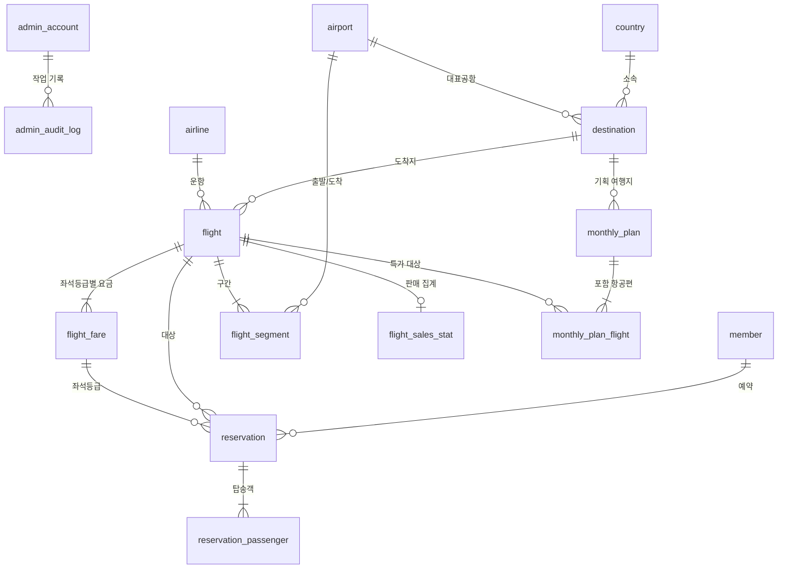

# nado_gam DB 설계서

> DBMS: MySQL 8 / 문자셋 utf8mb4 / 작성일: 2026-11-19 (초안)
> 관리자 영역과 사용자 영역을 구분해서 설계했다.

## 1. 영역 구분

| 영역 | 테이블 | 설명 |
|---|---|---|
| **[A] 관리자 영역** | `admin_account`, `admin_audit_log` | 관리자 계정, 관리자 작업 이력 |
| **[U] 사용자 영역** | `member`, `reservation`*, `reservation_passenger`* | 사용자 계정, 예약(2단계) |
| **[M] 운영 마스터** | `country`, `airport`, `destination`, `airline`, `flight`, `flight_segment`, `flight_fare`, `monthly_plan`, `monthly_plan_flight`, `flight_sales_stat` | 관리자가 등록·수정하고 사용자는 조회만 함 |

`*` = 2단계 구현. 이번에는 정의만 둔다.

규칙: 관리자와 사용자 계정은 **같은 테이블에 두지 않는다.** 로그인, 권한, 세션 처리가 서로 섞이지 않게 한다.

## 2. ERD



## 3. 테이블 정의서

### 3-1. [A] 관리자 영역

**admin_account** (관리자 계정)

| 컬럼 | 타입 | 제약 | 설명 |
|---|---|---|---|
| admin_id | BIGINT | PK, AI | |
| login_id | VARCHAR(30) | UNIQUE, NOT NULL | 로그인 아이디 |
| password_hash | VARCHAR(100) | NOT NULL | BCrypt 해시 |
| name | VARCHAR(50) | NOT NULL | |
| phone | VARCHAR(20) | NOT NULL | |
| email | VARCHAR(100) | UNIQUE, NOT NULL | |
| role | VARCHAR(20) | NOT NULL, 기본 `ROLE_ADMIN` | |
| status | VARCHAR(10) | NOT NULL, 기본 `ACTIVE` | ACTIVE / LOCKED |
| last_login_at | DATETIME | NULL | |
| created_at | DATETIME | NOT NULL | |

**admin_audit_log** (관리자 작업 이력)

| 컬럼 | 타입 | 제약 | 설명 |
|---|---|---|---|
| log_id | BIGINT | PK, AI | |
| admin_id | BIGINT | FK → admin_account | |
| action | VARCHAR(30) | NOT NULL | CREATE / UPDATE / DELETE / LOGIN |
| target_table | VARCHAR(50) | NOT NULL | |
| target_id | VARCHAR(50) | NULL | |
| detail | TEXT | NULL | 변경 내용 |
| created_at | DATETIME | NOT NULL | |

### 3-2. [U] 사용자 영역

**member** (사용자 계정)

| 컬럼 | 타입 | 제약 | 설명 |
|---|---|---|---|
| member_id | BIGINT | PK, AI | |
| login_id | VARCHAR(30) | UNIQUE, NOT NULL | |
| password_hash | VARCHAR(100) | NOT NULL | BCrypt 해시 |
| name | VARCHAR(50) | NOT NULL | |
| phone | VARCHAR(20) | NOT NULL | |
| email | VARCHAR(100) | UNIQUE, NOT NULL | |
| role | VARCHAR(20) | NOT NULL, 기본 `ROLE_USER` | |
| status | VARCHAR(10) | NOT NULL, 기본 `ACTIVE` | ACTIVE / SUSPENDED / WITHDRAWN |
| created_at | DATETIME | NOT NULL | |
| updated_at | DATETIME | NOT NULL | |
| withdrawn_at | DATETIME | NULL | 탈퇴 일시(소프트 삭제) |

**reservation** (2단계) / **reservation_passenger** (2단계)

| 테이블 | 핵심 컬럼 |
|---|---|
| reservation | reservation_id PK, member_id FK, flight_id FK, fare_id FK, departure_date, passenger_count, total_price, status(PENDING/CONFIRMED/CANCELED), created_at, version(낙관적 락) |
| reservation_passenger | passenger_id PK, reservation_id FK, name_ko, name_en, birth_date, passenger_type(ADULT/CHILD/INFANT), passport_no(암호화 저장 검토) |

### 3-3. [M] 운영 마스터

**country** (국가)

| 컬럼 | 타입 | 설명 |
|---|---|---|
| country_code | CHAR(2) PK | ISO 국가 코드 (KR, JP …) |
| name_ko / name_en | VARCHAR(50) | |
| region | VARCHAR(20) | EUROPE / ASIA / NORTH_AMERICA / SOUTH_AMERICA / MIDDLE_EAST / AFRICA / OCEANIA |

**airport** (공항)

| 컬럼 | 타입 | 설명 |
|---|---|---|
| airport_code | CHAR(3) PK | IATA 코드 (ICN, CDG …) |
| name_ko / name_en | VARCHAR(100) | |
| city_name_ko | VARCHAR(50) | |
| country_code | CHAR(2) FK | |
| latitude / longitude | DECIMAL(9,6) | **지구본 좌표** |
| timezone | VARCHAR(40) | 예: Asia/Seoul |
| is_hub | BOOLEAN | 경유 거점 여부 (FRA, IST, DXB …) |

**destination** (여행지 = 27개 도시)

| 컬럼 | 타입 | 설명 |
|---|---|---|
| destination_id | BIGINT PK AI | |
| name_ko / name_en | VARCHAR(50) | |
| country_code | CHAR(2) FK | |
| main_airport | CHAR(3) FK | 대표 공항 |
| latitude / longitude | DECIMAL(9,6) | 도시 중심 좌표 |
| status | VARCHAR(15) | AVAILABLE / UNAVAILABLE |
| unavailable_reason | VARCHAR(200) | 운항 불가 사유 (블라디보스토크 등) |
| summary | VARCHAR(300) | 한 줄 소개 |
| image_url | VARCHAR(300) | 사진 포스터용(지금은 비워 둠) |
| poster_color_from / poster_color_to | CHAR(7) | 카드 포스터 그라데이션 색(#RRGGBB). 사진이 없을 때 CSS 로 포스터를 만든다 |
| sort_order | INT | |

**airline** (항공사)

| 컬럼 | 타입 | 설명 |
|---|---|---|
| airline_code | VARCHAR(3) PK | 항공사 코드 (MG, AQ …). **실제 항공사와 무관한 가상 코드**이다 |
| name_ko / name_en | VARCHAR(50) | |
| carrier_type | VARCHAR(5) | FSC(일반) / LCC(저비용) |

**flight** (항공편)

| 컬럼 | 타입 | 설명 |
|---|---|---|
| flight_id | BIGINT PK AI | |
| flight_no | VARCHAR(10) | 편명 |
| airline_code | VARCHAR(3) FK | |
| destination_id | BIGINT FK | 도착 도시 |
| origin_airport | CHAR(3) FK | 최초 출발 공항 |
| arrival_airport | CHAR(3) FK | 최종 도착 공항 |
| flight_type | VARCHAR(10) | DIRECT / CONNECTING |
| stops | TINYINT | 경유 횟수 (직항 0) |
| departure_time | TIME | 출발 시각(출발지 현지) |
| arrival_time | TIME | 도착 시각(도착지 현지) |
| arrival_day_offset | TINYINT | 도착이 며칠 뒤인지 (0/1) |
| duration_minutes | INT | 총 소요 시간(분, 경유 대기 포함) |
| aircraft | VARCHAR(30) | 기종 |
| baggage_kg | INT | 위탁 수하물 무게 |
| meal_included | BOOLEAN | 기내식 |
| operating_days | VARCHAR(7) | 운항 요일 (예: 1111111) |
| status | VARCHAR(10) | ON_SALE / SOLD_OUT / SUSPENDED |
| created_at / updated_at | DATETIME | |

**flight_segment** (경유 구간. 직항도 구간 1개)

| 컬럼 | 타입 | 설명 |
|---|---|---|
| segment_id | BIGINT PK AI | |
| flight_id | BIGINT FK | |
| seq | TINYINT | 구간 순서 (1, 2) |
| from_airport / to_airport | CHAR(3) FK | |
| duration_minutes | INT | 구간 비행시간 |
| layover_minutes | INT | 다음 구간 대기 시간 (마지막 구간은 NULL) |

**flight_fare** (좌석등급별 요금)

| 컬럼 | 타입 | 설명 |
|---|---|---|
| fare_id | BIGINT PK AI | |
| flight_id | BIGINT FK | |
| cabin_class | VARCHAR(10) | ECONOMY / PREMIUM / BUSINESS / FIRST |
| base_price | INT | 운임 (원) |
| tax_fuel | INT | 세금·유류할증료 |
| seats_total | INT | 총 좌석 수 |
| seats_left | INT | 잔여 좌석 |
| refundable | BOOLEAN | 환불 가능 여부 |
| change_fee | INT | 변경 수수료 |
| mileage_rate | DECIMAL(3,2) | 마일리지 적립률 |
| version | BIGINT | **낙관적 락**(동시 예약 대비) |

표시 가격 = `base_price + tax_fuel` (더미 CSV 의 가격이 이 합계이다. 세금·유류할증료는 총 소요시간 기준 3만/6만/12만/15만 원). UNIQUE(flight_id, cabin_class). 좌석등급을 갖지 않는 항공편(예: LCC는 일반석만)은 해당 행을 만들지 않는다.

**monthly_plan** (이달의 특별기획)

| 컬럼 | 타입 | 설명 |
|---|---|---|
| plan_id | BIGINT PK AI | |
| plan_month | CHAR(7) | 예: 2026-11 |
| destination_id | BIGINT FK | 기획 여행지 |
| title / subtitle | VARCHAR(100/200) | 마케팅 문구 |
| badge_text | VARCHAR(20) | 예: "최대 32% OFF" |
| highlights | VARCHAR(500) | 추천 포인트 (줄바꿈 구분 3줄) |
| start_at / end_at | DATETIME | 노출·특가 기간 |
| is_active | BOOLEAN | |
| banner_image | VARCHAR(300) | |

**monthly_plan_flight** (기획전 항공편과 특가)

| 컬럼 | 타입 | 설명 |
|---|---|---|
| plan_id / flight_id / cabin_class | FK 복합 PK | 등급마다 특가가 달라서 cabin_class 를 PK 에 포함 (구현 시 확정) |
| sale_price | INT | 특가 |
| original_price | INT | 정가(취소선 표시용) |
| limited_seats | INT | 특가 한정 좌석 수 |
| display_order | INT | |

**flight_sales_stat** (베스트셀러 집계)

| 컬럼 | 타입 | 설명 |
|---|---|---|
| flight_id | BIGINT PK FK | |
| sales_count | INT | 누적 판매 수 (초기 더미 → 예약 기능 후 실제 집계) |
| rank_no | INT | 순위 (집계 후 갱신) |
| updated_at | DATETIME | |

### 3-4. 출발지 목록 조회 (여행지 선택 후)

출발지는 별도 컬럼이 아니라 항공편 데이터에서 구한다. (확정 11/19)

```sql
SELECT DISTINCT a.airport_code, a.name_ko, a.city_name_ko
FROM flight f
JOIN airport a ON a.airport_code = f.origin_airport
WHERE f.destination_id = :destinationId
  AND f.status = 'ON_SALE'
ORDER BY a.city_name_ko;
```

`flight(destination_id, origin_airport)` 복합 인덱스를 둔다.

## 4. 추가로 둔 속성 (제안 사유)

| 속성 | 이유 |
|---|---|
| 공항 좌표 / 시간대 | 지구본 호와 현지 시각 계산에 필요 |
| `flight_segment` | 경유편에서 경유지, 구간별 시간과 대기 시간을 보여주기 위해 |
| 도착 일자 오프셋(`arrival_day_offset`) | 야간 비행에서 "+1일" 도착 표시 |
| 운항 불가 상태·사유 | 블라디보스토크 표시 요구사항 |
| 수하물, 기내식, 기종, 운항 요일 | 실제 항공권 상세 화면의 기본 정보 |
| 환불·변경 수수료, 마일리지 | 좌석등급별 조건 비교 |
| 잔여 좌석 + `version` | 특가 잔여 좌석 표시와 동시 예약(낙관적 락) 대비 |
| 감사 로그 | 관리자 작업 추적 |
| 소프트 삭제(`WITHDRAWN`) | 탈퇴 후에도 예약 이력 무결성을 유지 |

## 5. 설계 결정과 주의점

- 비밀번호는 평문이 아닌 **BCrypt 해시**로 저장한다. 관리자 `1234` 도 시드 데이터에는 해시로 넣는다.
- 항공편은 날짜가 아닌 **운항 템플릿**이다. 날짜별 재고가 필요해지는 2단계(예약)에서 `flight_schedule(flight_id, departure_date)` 로 분리해 `flight_fare` 의 좌석 재고를 이동할지 검토한다.
- 시각은 각 공항의 현지 시각 기준이다(시드는 표준시 기준, 서머타임 미반영).
- 특별기획 가격은 `flight_fare` 를 바꾸지 않고 `monthly_plan_flight` 에서만 덮어쓴다(정가 보존).
